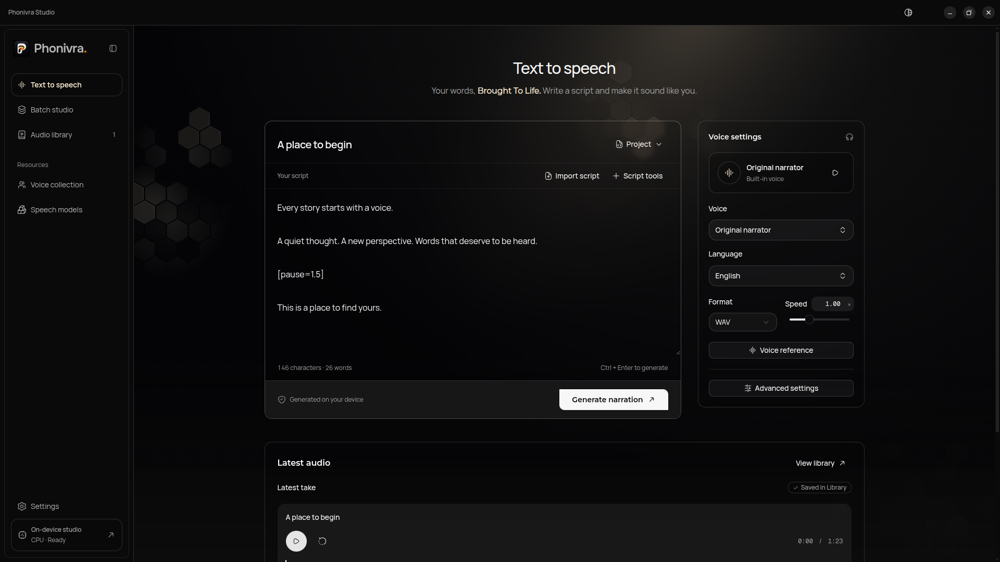

# Phonivra

Phonivra is an open-source, local-first desktop text-to-speech studio for turning scripts into narration on your own hardware. Write or import a script, choose a voice, and export audio with subtitles and a transcript.



**Status:** Phonivra is in active development. Use the source setup below to try it. See the [desktop release guide](apps/desktop/RELEASE.md) for installer targets and packaging.

## What you can do

- Narrate scripts in multiple languages, with language detection and pronunciation overrides.
- Record or import a voice reference, save it as a preset, and audition it before generating.
- Generate several scripts as a batch or split a script into chapters.
- Adjust pacing and mastering, export audio and companion files, and revisit completed work in the library.

Synthesis runs locally. The app downloads model weights from Hugging Face and caches them for offline use. Scripts, reference recordings, and generated audio stay on your device. Model capabilities vary by checkpoint. See the [engine guide](apps/engine/README.md) for storage, device selection, and offline behavior.

## Models and generated audio

Phonivra offers **Chatterbox Multilingual V3** for narration in 23 languages, **Chatterbox Turbo** for English narration with reaction tags, and **AI4Bharat IndicF5** for 11 Indian languages. IndicF5 requires a Hugging Face read token to download and a saved voice preset with its transcript to generate.

See [Using generated audio](GENERATED_AUDIO.md) before publishing or selling narration, especially when using a cloned voice. The [third-party notices](THIRD_PARTY_NOTICES.md) list the model sources, exact revisions, and upstream credits.

## Development

### Run the desktop app

You need Git, Node.js 24.22.0 or later within Node 24, pnpm 12.15.0, Python 3.11–3.13 (3.12 recommended), uv, and FFmpeg with FFprobe on your PATH. Run these commands in a graphical desktop session.

```sh
git clone https://github.com/AbhishekSinghDev/phonivra.git
cd phonivra
pnpm install --frozen-lockfile
pnpm engine:setup
pnpm dev:desktop
```

Engine setup installs Python dependencies into a project-local virtual environment. Electron starts the engine when the app opens. For a CPU-only setup, use `pnpm engine:setup --cpu`. See the [engine setup guide](apps/engine/README.md#development-setup) for alternate runtimes and platform details.

On first launch, Phonivra checks the local runtime and audio tools, then helps you choose a narration language and install a compatible model. Generate a short test clip to unlock the studio. In **Text to speech**, enter a script and generate a narration. Play the finished take or export it from the result panel.

### Run the website

With the JavaScript dependencies installed, run `pnpm dev:website` from the root and open [localhost:3000](http://127.0.0.1:3000). The website runs independently of the Python engine.

### Workspaces

| Workspace                      | Responsibility                                                         |
| ------------------------------ | ---------------------------------------------------------------------- |
| [`apps/desktop`](apps/desktop) | Electron and React studio, native integration, and installer packaging |
| [`apps/engine`](apps/engine)   | Python speech synthesis, model downloads, jobs, and local storage      |
| [`apps/website`](apps/website) | Next.js marketing site                                                 |
| [`packages/ui`](packages/ui)   | Shared UI components, hooks, fonts, and theme                          |

The desktop app manages the engine over an authenticated loopback connection. The desktop renderer reaches native features through the typed Electron preload bridge. Both frontends compile the shared UI package directly.

### Checks

Run the checks relevant to your change from the repository root. The lint tasks require uv for the Python engine.

```sh
pnpm typecheck
pnpm lint
pnpm format:check
pnpm build
```

See the [CI workflow](.github/workflows/checks.yml) for the full validation sequence and the [workspace guides](AGENTS.md) for scoped commands. Exercise changed desktop flows in Electron with a prepared engine.

### Shared UI and adding components

Import components through public paths such as `@phonivra/ui/components/button`. Keep reusable components and theme styles in `packages/ui`. Both apps import `@phonivra/ui/globals.css` and scan their own sources for Tailwind classes.

Preview registry additions from the repository root before applying them.

```sh
pnpm ui:add @shadcn/aspect-ratio --dry-run
pnpm ui:add @shadcn/aspect-ratio
```

When updating an existing component, inspect the proposed changes with `pnpm ui:add @shadcn/accordion --diff` and preserve project-specific styling and behavior. Verify shared UI changes in both apps.

## Help and contributing

Report bugs and discuss changes in [GitHub Issues](https://github.com/AbhishekSinghDev/phonivra/issues). For setup, verification, and pull request guidance, see [Contributing](CONTRIBUTING.md).

## License

Phonivra’s original code is available under the [MIT License](LICENSE). Downloaded model weights and bundled third-party software are governed by their respective licenses.
